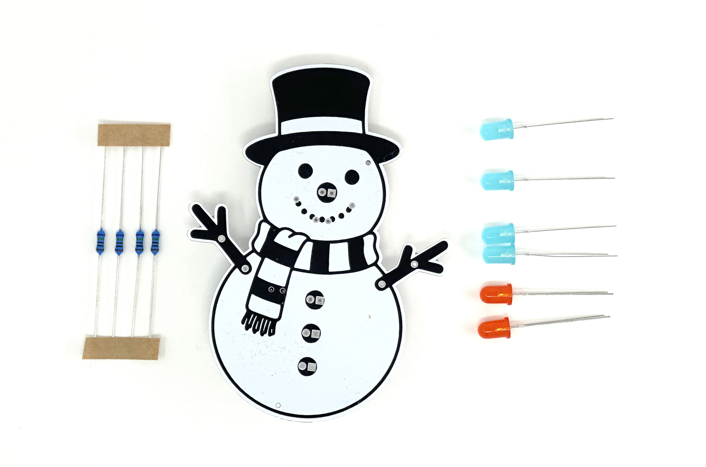
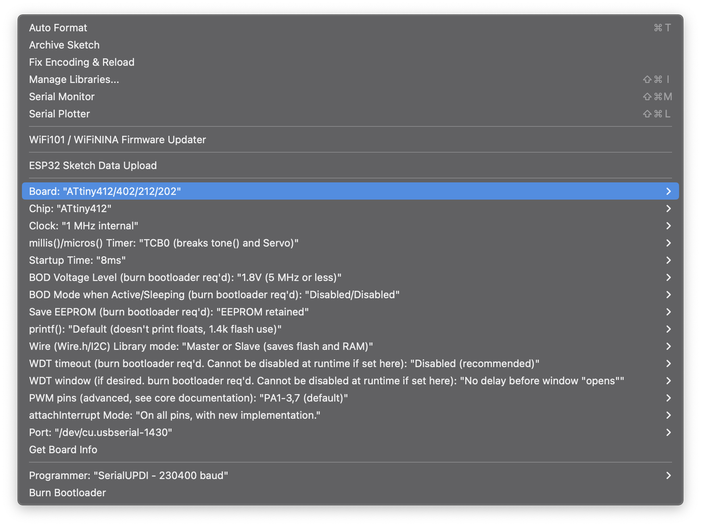

# Snowman solder kit
This charming solder kit for kids (or others with short attention spans) is [available from Maketronics webshop](https://maketronics.no/shop/snowman-solder-kit/). This repository holds the [schematic](../schematic/Snowman.pdf) and code that comes with the kit.

## Hacking it

Feel free to hack the code as you like. To do so, you'll need a Serial UPDI programmer [like this one](https://www.tindie.com/products/ragone/nanoupdi-usb-c-serial-updi-programmer/).

The existing code has several defines at the top that let you tweak how the kit works. You can also use the [schematic](../schematic/Snowman.pdf) and the defines at the top of the file.

The below image shows the Arduino IDE settings to use with [MegaTinyCore](https://github.com/SpenceKonde/megaTinyCore).

## Organizing a workshop
In [the folder named "slides"](./slides), you can find the presentations we use for the workshops we organize aound this kit. Feel free to use these as a starting point for your own workshops. All graphics used are assumed to be in the public domain or made by me. Please get in touch if that is incorrect.